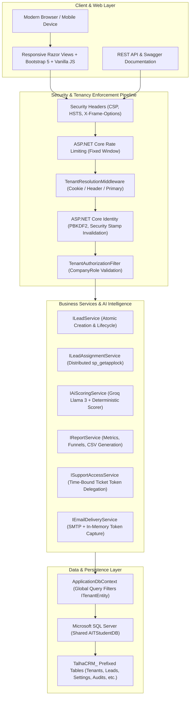
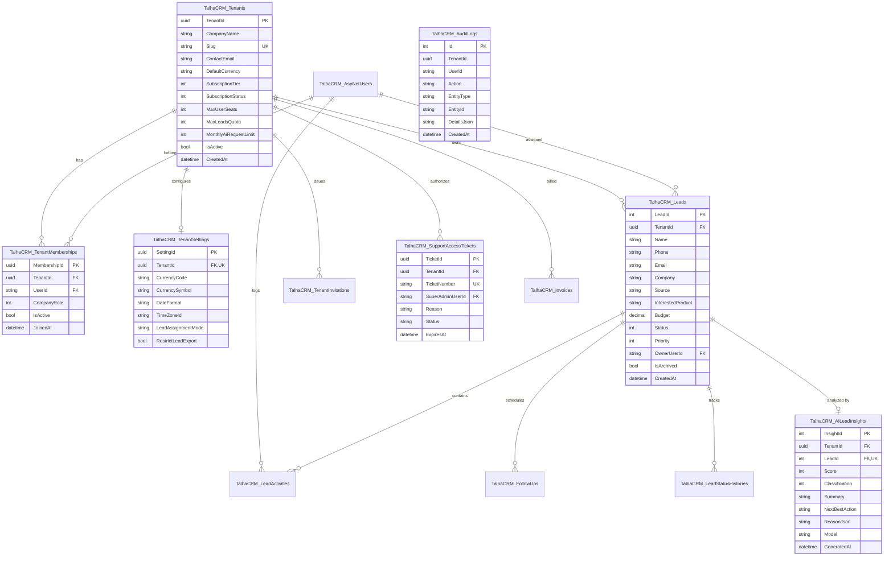
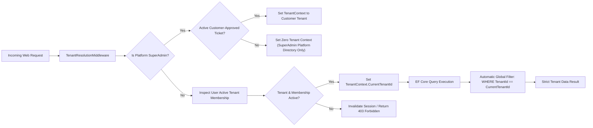
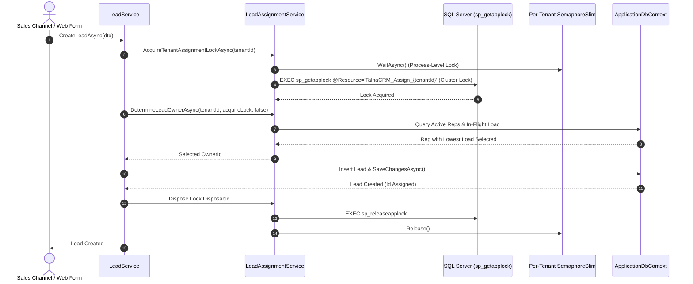

# AI-Powered CRM — Multi-Tenant Commercial SaaS

A production-grade, multi-tenant AI-Powered Customer Relationship Management (CRM) commercial SaaS platform built on **ASP.NET Core 8 MVC**, **Entity Framework Core 8**, **Microsoft SQL Server**, and **Groq AI (Llama 3)**.

Designed for high-velocity sales organizations, the platform delivers bulletproof multi-company workspace isolation, distributed concurrency-safe round-robin lead routing (`sp_getapplock` + `SemaphoreSlim`), intelligent lead scoring with zero-cost deterministic fallback, rich interactive Kanban pipeline management, real-time analytics with CSV exports, and centralized Platform SuperAdmin operations with customer-controlled delegated support access.

---

## 🏛️ System Architecture



---

## 🗄️ Entity-Relationship Schema (`TalhaCRM_` Isolated Namespace)

The platform operates in a shared SQL Server database (`AITStudentDB`) without colliding with any legacy or student tables. All CRM tables are strictly segregated with the `TalhaCRM_` prefix:



---

## 🔒 Multi-Tenant Data Isolation & Query Filtering

Multi-tenancy is enforced natively in the data access layer via Entity Framework Core Global Query Filters:



### Core Tenancy Rules:
1. **Global Query Filters:** All entities implementing `ITenantEntity` automatically append `WHERE TenantId = @CurrentTenantId` to every generated SQL query.
2. **Defense-in-Depth:** In-memory verification verifies `TenantId` consistency before entity additions, updates, and soft deletes.
3. **Cross-Tenant Attack Prevention:** Direct URL tampering (e.g. requesting `/Leads/Details/123` belonging to another company) returns an immediate HTTP 404 / `null`, never leaking customer records or existence proofs.

---

## ⚡ Concurrency-Safe Round-Robin Lead Assignment

To prevent duplicate owner assignments and race conditions in high-concurrency environments, `LeadAssignmentService` employs a two-tier locking model:



1. **Distributed Cluster Synchronization:** Executes `sp_getapplock` on resource `$"TalhaCRM_Assign_{tenantId:N}"` with transaction/session binding. Safe across multiple deployed web nodes.
2. **Process-Level Thread Safety:** Combines SQL Server locks with per-tenant `SemaphoreSlim` instances to serialize concurrent threads within a single process.
3. **In-Flight Load Compensation:** Tracks active uncommitted assignments in an in-memory concurrent ledger to balance loads accurately before database writes complete.

---

## 👑 Secure Platform SuperAdmin Operations & Bootstrapping

Platform SuperAdmins manage SaaS health and tenant workspaces from `/Platform`.

### Zero-Trust Privacy Model:
- **Zero Tenant Memberships:** SuperAdmins have **zero** `TenantMembership` records.
- **Lead Privacy Boundary:** SuperAdmins **cannot view or browse customer leads** under any circumstances without an approved, customer-generated, time-bound `SupportAccessTicket`.
- **Automatic Routing:** SuperAdmin logins bypass tenant workspaces and route directly to `/Platform`.

### Collision-Safe Bootstrapping:
`DbInitializer.cs` bootstraps the initial Platform SuperAdmin with strict collision detection:
1. If the configured bootstrap email already belongs to a user with tenant memberships, elevation is **strictly refused**, and a security event is logged.
2. If the user already exists as a dedicated SuperAdmin, passwords and settings are preserved without duplicate records.
3. Bootstrapping is configured via environment variables:
   ```bash
   CRM_SUPERADMIN_EMAIL="superadmin@crm-platform.com"
   CRM_SUPERADMIN_PASSWORD="YourSecurePassword!2026"
   CRM_SUPERADMIN_FULLNAME="Platform Operations Lead"
   ```

---

## 💰 Subscription & Billing (Frontend-Ready Commercial SaaS)

In accordance with commercial roadmap specifications, **payment gateway backend integration (Stripe / Razorpay / UPI webhooks) is scheduled for the FINAL development phase**.

The entire frontend experience is fully designed, tested, and operational:
- **Plans & Pricing (`/Subscription/Pricing`):**
  - **Free Trial:** ₹0 / month (5 seats, 1,000 leads, 200 AI credits).
  - **Starter:** ₹1,999 / month (10 seats, 5,000 leads, 1,000 AI credits).
  - **Professional (Recommended):** ₹4,999 / month (25 seats, 25,000 leads, 5,000 AI credits).
  - **Enterprise:** ₹14,999 / month (100+ seats, 100,000+ leads, unlimited AI credits).
- **Billing Cycle Toggle:** Instant Monthly vs. Annual toggle (20% discount badge and monthly equivalent display).
- **Comprehensive Feature Comparison Matrix:** Side-by-side evaluation table across all four tiers.
- **Safety Modal:** Selecting a paid tier opens a professional `#paymentComingSoonModal` with contact instructions and zero financial risk notice.
- **Subscription Dashboard (`/Subscription`):** Real-time quota progress bars (Seats, Leads, AI usage) and renewal metadata.
- **Invoicing History (`/Subscription/BillingHistory`):** Invoice-style transaction records with Indian Rupee (`₹`) symbols and download prompts.

---

## 🚀 Free Hosting & Production Deployment Guide

The application is engineered to deploy seamlessly to standard free and cost-effective hosting platforms:

### Option A: Azure App Service (Free F1 Tier) + Azure SQL Free
1. **Web App:** Deploy via GitHub Actions or VS Code to Azure App Service Linux/Windows Free F1 plan (.NET 8 runtime).
2. **Database:** Azure SQL Database Free Tier (includes 100,000 vCore seconds free each month, 32 GB storage).
3. **Environment Variables Configuration (Azure Portal -> Configuration -> App Settings):**
   ```ini
   ConnectionStrings__DefaultConnection=Server=tcp:yourserver.database.windows.net,1433;Initial Catalog=AITStudentDB;User ID=youruser;Password=yourpass;Encrypt=True;TrustServerCertificate=False;
   Security__SuperAdminBootstrap__Email=superadmin@crm-platform.com
   Security__SuperAdminBootstrap__Password=YourProductionSecretPassword!2026
   Security__SuperAdminBootstrap__FullName=Platform Operations Lead
   Groq__ApiKey=gsk_your_groq_api_key_here
   EmailSettings__SmtpServer=smtp.sendgrid.net
   EmailSettings__SmtpPort=587
   EmailSettings__SenderEmail=no-reply@yourdomain.com
   EmailSettings__SenderName=NexusCRM
   EmailSettings__Username=apikey
   EmailSettings__Password=your_sendgrid_api_key
   ```

### Option B: Render / Railway (Docker Linux Container)
1. Build and run using the .NET 8 multi-stage Dockerfile.
2. Expose port `8080` (default ASP.NET Core 8 container port).
3. Connect to external SQL Server or existing shared `AITStudentDB`.

---

## 🧪 Comprehensive Automated Test Suite

The test suite contains **136 automated tests** spanning integration workflows, concurrency locks, security controls, and multi-tenant isolation.

```
Total Tests:    136
Passed:         136
Failed:         0
Skipped:        0
Pass Rate:      100%
Execution Time: ~14 seconds
```

### Test Suite Structure:
- `TwoCompanyEndToEndWorkflowTests.cs`: Full lifecycle validation of two independent organizations ("Alpha Technologies" and "Beta Logistics") covering registration, email confirmation, employee invitations, role modifications, deactivation defenses, lead creation, Kanban stage transitions, AI fallback analysis, analytics reporting, CSV export isolation, workspace settings, and Platform SuperAdmin tier updates.
- `SprintHardeningTests.cs`: SuperAdmin bootstrap collision rejection, idempotent re-runs, and email delivery reliability (accurate status, development capture, token masking).
- `SqlServerLeadAssignmentConcurrencyIntegrationTests.cs`: Multi-instance SQL Server distributed application lock coordination (`sp_getapplock` / `sp_releaseapplock`), tenant isolation under load, and round-robin distribution fairness.
- `TenantIsolationTests.cs` & `Phase3TenantSwitchingAndSubscriptionTests.cs`: Cross-tenant boundary enforcement, Global Query Filters, workspace switching, and subscription quota tracking.
- `SupportAccessServiceTests.cs` & `SqlServerSupportAccessIntegrationTests.cs`: Time-bound support ticket delegation, token hashing, expiration, and customer-approved revocation.
- `DeterministicScorerTests.cs`: AI lead qualification and scoring rules engine fallback.

To execute the complete test suite locally:
```powershell
powershell -ExecutionPolicy Bypass -Command "dotnet test tests/AIPoweredCRM.Tests/AIPoweredCRM.Tests.csproj"
```

---

## 📖 Quick-Start Local Development

### Prerequisites:
- [.NET 8.0 SDK](https://dotnet.microsoft.com/download/dotnet/8.0)
- Microsoft SQL Server 2019+ or LocalDB

### Step 1: Clone Repository
```bash
git clone https://github.com/Talhashaikh0501/AI-Powered-CRM.git
cd AI-Powered-CRM
```

### Step 2: Configure Connection String
Edit `appsettings.Development.json`:
```json
{
  "ConnectionStrings": {
    "DefaultConnection": "Server=(localdb)\\mssqllocaldb;Database=AITStudentDB;Trusted_Connection=True;MultipleActiveResultSets=true;TrustServerCertificate=True"
  }
}
```

### Step 3: Run the Application
```bash
dotnet run
```
Navigate to `https://localhost:5001`. The database seed will automatically initialize roles, settings, and the initial Platform SuperAdmin.