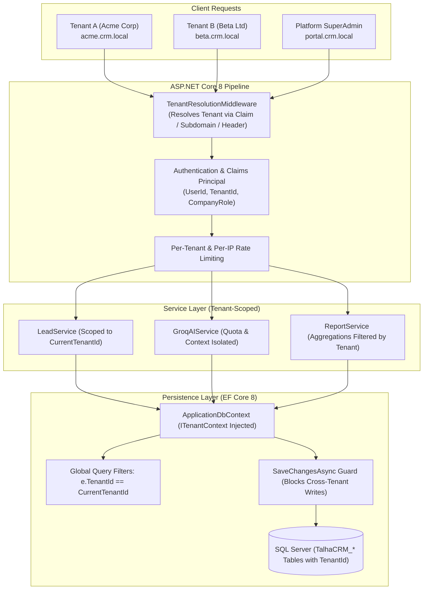

# Phase 2: Commercial Multi-Tenant SaaS Architecture & Migration Plan

**Project:** AI-Powered CRM Commercial SaaS  
**Target Framework:** .NET 8 (ASP.NET Core MVC / EF Core 8 / Microsoft SQL Server)  
**Author:** Senior ASP.NET Core Security Engineer & Database Architect  
**Status:** Architecture Proposal & Migration Specification — Pending Review & Approval  
**Date:** October 15, 2026  

---

## 1. Baseline Verification & Pre-Flight Status

Prior to initiating Phase 2 architectural design, the entire solution was compiled and verified using the automated regression test suite:

- **Build Result:** Succeeded (0 Errors, 0 Warnings)
- **Unit & Security Regression Tests:** **30 Passed**, **0 Failed**, **0 Skipped** (Duration: 4.1s)
- **Security Coverage:** Lead ownership enforcement, Groq HTTP response parsing & prompt injection sanitization, WebApplicationFactory HTTP 429 login rate limiting, immediate session revocation upon deactivation, and real HTTP status validation (401, 403, 302).
- **Compliance Status:** All Phase 1 requirements fully satisfied.

---

## 2. Multi-Tenancy Architecture Overview

To support a commercial SaaS serving hundreds of independent businesses securely, cost-effectively, and with strict compliance, the CRM adopts the **Shared Database, Shared Schema with Automated Discriminator & Global Query Filter** multi-tenancy model.



### Core Architecture Principles:
1. **Zero Data Leakage:** Every tenant's records are physically tagged with a non-sequential `TenantId` (UUID/Guid).
2. **Double-Layered Defense:**
   - **Database / EF Core Layer:** Global query filters (`HasQueryFilter`) ensure no query can return another tenant's records even if a developer omits a `Where` clause.
   - **Service / Handler Layer:** Resource-based authorization handlers explicitly verify `tenantId == currentTenantId`.
3. **ORM Write Protection:** Overridden `SaveChangesAsync` verifies that every inserted or modified entity matches the active tenant context, throwing a `SecurityException` upon any cross-tenant write attempt.
4. **Subscription Quota Enforcers:** Enforces user seat limits, lead storage quotas, and monthly AI inference allocations per company.

---

## 3. Role Separation & Identity Hierarchy

Phase 2 formally separates **Platform Management** from **Company CRM Operations**.

```
Platform SuperAdmin (Global SaaS Owner / Billing / Platform Maintenance)
  │
  ├── Tenant A (Acme Corp)
  │     ├── CompanyAdmin (Full company control, billing, invitations, settings)
  │     ├── Manager (Team lead assignment, reports, pipeline analytics)
  │     └── SalesExecutive (Assigned leads, activities, personal follow-ups)
  │
  └── Tenant B (Beta Ltd)
        ├── CompanyAdmin
        ├── Manager
        └── SalesExecutive
```

### 3.1 Role Definitions

| Role | Scope | Key Capabilities | Restricted From |
|---|---|---|---|
| **PlatformSuperAdmin** | System-Wide | Manage tenants, view global SaaS metrics, change subscription plans, suspend delinquent tenants, inspect platform audit logs. | Accessing tenant customer lead details unless in audited support mode. |
| **CompanyAdmin** | Tenant-Only | Full CRUD on company leads, assign leads, configure tenant settings (currency, business hours), invite/deactivate staff, view billing. | Viewing other tenants' data or platform administrative controls. |
| **Manager** | Tenant-Only | View all company leads, reassign leads, approve deals, view conversion & sales leaderboard reports, view AI pipeline analytics. | Modifying company subscription, managing tenant billing, inviting admins. |
| **SalesExecutive** | Tenant-Only | Create leads (assigned to self), view/update owned leads, log activities, schedule follow-ups, trigger AI analysis for owned leads. | Viewing other reps' restricted leads, company-wide reports, tenant settings. |

### 3.2 Tenant Context & Claims Specification

Upon authentication, the user identity contains the following structured claims:

- `sub` / `ClaimTypes.NameIdentifier`: Unique User ID (GUID string).
- `crm:tenant_id`: Active Tenant ID (GUID string).
- `crm:tenant_slug`: Unique company slug (e.g., `acme-corp`).
- `crm:company_role`: `CompanyAdmin` | `Manager` | `SalesExecutive`.
- `ClaimTypes.Role`: Mapped to `CompanyRole` for standard ASP.NET Core authorization policies (`[Authorize(Roles = "CompanyAdmin,Manager")]`).

### 3.3 Platform SuperAdmin Server-Verified Delegated Support Protocol (Zero-Trust)

Platform SuperAdmins manage SaaS subscriptions, tenant lifecycles, and system configuration. They do NOT hold implicit or automatic company memberships. Blanket bypass wildcards on EF Core global query filters have been eliminated.

To access tenant data during a customer support incident, the following strict zero-trust protocol is enforced:
1. **Server-Verified Active Support Ticket Required:**
   - Platform SuperAdmin passes `X-Tenant-ID` and `X-Support-Ticket` (or `X-Support-Reason`).
   - The server verifies against `TalhaCRM_SupportAccessTickets`:
     - Must match target `TenantId`.
     - Must match `TicketNumber` or `TicketId`.
     - `Status == "Approved"`.
     - Current time within validity window (`DateTime.UtcNow <= ExpiresAt`).
     - Admin matches assigned `SuperAdminUserId` (or unassigned).
   - Self-declared reasons without a server-approved database record are immediately denied with **HTTP 403 Forbidden**.
2. **Fail-Closed Mandatory Security Audit Trail:**
   - Every delegated session attempts to persist an immutable audit record to `TalhaCRM_AuditLogs` (`Action = PlatformSuperAdminDelegatedAccess`).
   - If writing the audit record fails for any reason (disk full, DB error), the system **FAILS CLOSED**: clears tenant context, returns **HTTP 500 Internal Server Error**, and aborts request processing.
   - `IgnoreTenantFilter` is safely restored to `false` in a `finally` block to prevent tenant filter leaks.
3. **Isolated Query Scoping:** EF Core query filters strictly scope data to the delegated tenant context (`IsTenantResolved && e.TenantId == CurrentTenantId`), preventing accidental cross-tenant data leaks.

### 3.4 Explicit Tenant-Aware Authorization Policies (No Path Guessing)

Reliance on fragile URL string prefix guessing (`IsProtectedTenantPath`) has been eliminated in favor of native ASP.NET Core authorization policies:
- **`TenantRequired` Policy:** Backed by `TenantRequirement` and `TenantAuthorizationHandler`. Fails closed unless the user is authenticated and `_tenantContext.IsResolved` is `true`.
- **Controller Enforcement:** Every CRM controller and API endpoint explicitly declares `[Authorize(Policy = "TenantRequired")]` (including `LeadsController`, `ReportsController`, `DashboardController`, `PipelineController`, `FollowUpsController`, `AdminController`, and `CrmApiControllers`).
- **Company Admin Isolation:** `AdminController` explicitly scopes user lists and user status toggling to `TenantMemberships` where `TenantId == CurrentTenantId`, preventing cross-tenant user administrative tampering.

---

## 4. Entity-Relationship Diagram (ERD) & Schema Specification

```mermaid
erDiagram
    TalhaCRM_Tenants ||--o{ TalhaCRM_TenantMemberships : "employs"
    TalhaCRM_Tenants ||--o{ TalhaCRM_TenantInvitations : "issues"
    TalhaCRM_Tenants ||--|| TalhaCRM_TenantSettings : "configures"
    TalhaCRM_Tenants ||--o{ TalhaCRM_TenantSubscriptions : "subscribes"

    TalhaCRM_AspNetUsers ||--o{ TalhaCRM_TenantMemberships : "belongs to"
    TalhaCRM_AspNetUsers ||--o{ TalhaCRM_TenantInvitations : "invited by"

    TalhaCRM_Tenants ||--o{ TalhaCRM_Leads : "owns"
    TalhaCRM_Tenants ||--o{ TalhaCRM_LeadActivities : "logs"
    TalhaCRM_Tenants ||--o{ TalhaCRM_FollowUps : "schedules"
    TalhaCRM_Tenants ||--o{ TalhaCRM_LeadStatusHistory : "tracks"
    TalhaCRM_Tenants ||--o{ TalhaCRM_AILeadInsights : "generates"
    TalhaCRM_Tenants ||--o{ TalhaCRM_Notifications : "delivers"
    TalhaCRM_Tenants ||--o{ TalhaCRM_AuditLogs : "audits"
    TalhaCRM_Tenants ||--o{ TalhaCRM_SupportAccessTickets : "authorizes"

    TalhaCRM_AspNetUsers ||--o{ TalhaCRM_SupportAccessTickets : "granted to"
    TalhaCRM_AspNetUsers ||--o{ TalhaCRM_Leads : "manages"
    TalhaCRM_Leads ||--o{ TalhaCRM_LeadActivities : "contains"
    TalhaCRM_Leads ||--o{ TalhaCRM_FollowUps : "has"
    TalhaCRM_Leads ||--o{ TalhaCRM_LeadStatusHistory : "records"
    TalhaCRM_Leads ||--o{ TalhaCRM_AILeadInsights : "analyzed by"

    TalhaCRM_Tenants {
        uuid TenantId PK
        string CompanyName
        string Slug UK
        string ContactEmail
        string Phone
        string DefaultCurrency
        string SubscriptionTier
        string SubscriptionStatus
        datetime TrialEndsAt
        datetime SubscriptionRenewsAt
        int MaxUserSeats
        int MaxLeadsQuota
        int MonthlyAiRequestLimit
        int CurrentMonthAiUsageCount
        bool IsActive
        datetime CreatedAt
        datetime UpdatedAt
    }

    TalhaCRM_TenantMemberships {
        uuid MembershipId PK
        uuid TenantId FK
        string UserId FK
        string CompanyRole
        bool IsActive
        datetime JoinedAt
        string InvitedByUserId FK
    }

    TalhaCRM_TenantSettings {
        uuid TenantId PK_FK
        string CurrencyCode
        string CurrencySymbol
        string DateFormat
        string TimeZoneId
        int FiscalYearStartMonth
        string LeadAssignmentMode
        bool RestrictLeadExport
        datetime UpdatedAt
    }

    TalhaCRM_TenantInvitations {
        uuid InvitationId PK
        uuid TenantId FK
        string Email
        string CompanyRole
        string TokenHash
        datetime ExpiresAt
        bool IsAccepted
        string InvitedByUserId FK
        datetime CreatedAt
    }

    TalhaCRM_Leads {
        int LeadId PK
        uuid TenantId FK
        string Name
        string Phone
        string Email
        string Company
        string Source
        string InterestedProduct
        decimal Budget
        string Status
        string Priority
        string OwnerUserId FK
        bool IsArchived
        datetime CreatedAt
        datetime UpdatedAt
    }
```

### 4.1 New Entity Definitions

#### 1. `Tenant` (`TalhaCRM_Tenants`)
- `TenantId` (`uniqueidentifier`, PK, Non-clustered default): Primary tenant key.
- `CompanyName` (`nvarchar(150)`, NOT NULL): Legal business name.
- `Slug` (`nvarchar(60)`, NOT NULL, Unique): Subdomain or URL-safe company identifier.
- `ContactEmail` (`nvarchar(180)`, NOT NULL): Primary company billing/contact email.
- `Phone` (`nvarchar(30)`, NULL): Contact telephone.
- `DefaultCurrency` (`nvarchar(10)`, NOT NULL, DEFAULT `'INR'`): Base currency code.
- `SubscriptionTier` (`nvarchar(30)`, NOT NULL, DEFAULT `'FreeTrial'`): Tier enum (`FreeTrial`, `Starter`, `Professional`, `Enterprise`).
- `SubscriptionStatus` (`nvarchar(30)`, NOT NULL, DEFAULT `'Trialing'`): Status enum (`Trialing`, `Active`, `PastDue`, `Canceled`, `Expired`).
- `TrialEndsAt` (`datetime2`, NULL): 14-day trial expiry date.
- `SubscriptionRenewsAt` (`datetime2`, NULL): Next renewal billing date.
- `MaxUserSeats` (`int`, NOT NULL, DEFAULT 5): Permitted staff accounts.
- `MaxLeadsQuota` (`int`, NOT NULL, DEFAULT 1000): Lead record ceiling.
- `MonthlyAiRequestLimit` (`int`, NOT NULL, DEFAULT 200): Monthly Groq AI allocations.
- `CurrentMonthAiUsageCount` (`int`, NOT NULL, DEFAULT 0): Current billing cycle usage.
- `IsActive` (`bit`, NOT NULL, DEFAULT 1): Company suspension switch.
- `CreatedAt` (`datetime2`, NOT NULL, DEFAULT `SYSUTCDATETIME()`).
- `UpdatedAt` (`datetime2`, NOT NULL, DEFAULT `SYSUTCDATETIME()`).

#### 2. `TenantMembership` (`TalhaCRM_TenantMemberships`)
- `MembershipId` (`uniqueidentifier`, PK): Unique membership identifier.
- `TenantId` (`uniqueidentifier`, NOT NULL, FK -> `TalhaCRM_Tenants`): Parent tenant.
- `UserId` (`nvarchar(450)`, NOT NULL, FK -> `TalhaCRM_AspNetUsers`): User account.
- `CompanyRole` (`nvarchar(30)`, NOT NULL): `CompanyAdmin`, `Manager`, `SalesExecutive`.
- `IsActive` (`bit`, NOT NULL, DEFAULT 1): Membership-specific active status.
- `JoinedAt` (`datetime2`, NOT NULL, DEFAULT `SYSUTCDATETIME()`).
- `InvitedByUserId` (`nvarchar(450)`, NULL, FK -> `TalhaCRM_AspNetUsers`).
- **Index:** Unique composite index on `(TenantId, UserId)`.

#### 3. `TenantSetting` (`TalhaCRM_TenantSettings`)
- `TenantId` (`uniqueidentifier`, PK, FK -> `TalhaCRM_Tenants`): 1:1 relationship with Tenant.
- `CurrencyCode` (`nvarchar(10)`, NOT NULL, DEFAULT `'INR'`).
- `CurrencySymbol` (`nvarchar(10)`, NOT NULL, DEFAULT N'₹').
- `DateFormat` (`nvarchar(30)`, NOT NULL, DEFAULT `'dd/MM/yyyy'`).
- `TimeZoneId` (`nvarchar(60)`, NOT NULL, DEFAULT `'India Standard Time'`).
- `FiscalYearStartMonth` (`int`, NOT NULL, DEFAULT 4): April for Indian fiscal calendar.
- `LeadAssignmentMode` (`nvarchar(30)`, NOT NULL, DEFAULT `'Manual'`): `Manual`, `RoundRobin`, `ManagerAssigned`.
- `RestrictLeadExport` (`bit`, NOT NULL, DEFAULT 1): Prevents non-admins from downloading lead databases.
- `UpdatedAt` (`datetime2`, NOT NULL, DEFAULT `SYSUTCDATETIME()`).

#### 4. `TenantInvitation` (`TalhaCRM_TenantInvitations`)
- `InvitationId` (`uniqueidentifier`, PK).
- `TenantId` (`uniqueidentifier`, NOT NULL, FK -> `TalhaCRM_Tenants`).
- `Email` (`nvarchar(180)`, NOT NULL).
- `CompanyRole` (`nvarchar(30)`, NOT NULL).
- `TokenHash` (`nvarchar(256)`, NOT NULL): SHA-256 hash of random invite token.
- `ExpiresAt` (`datetime2`, NOT NULL): Token expiry (typically 7 days).
- `IsAccepted` (`bit`, NOT NULL, DEFAULT 0).
- `InvitedByUserId` (`nvarchar(450)`, NOT NULL, FK -> `TalhaCRM_AspNetUsers`).
- `CreatedAt` (`datetime2`, NOT NULL, DEFAULT `SYSUTCDATETIME()`).

---

## 5. EF Core 8 Global Query Filter & Tenant Injection

### 5.1 Marker Interface
```csharp
namespace AI_Powered_CRM.Models.Interfaces
{
    public interface ITenantEntity
    {
        Guid TenantId { get; set; }
    }
}
```

### 5.2 Tenant Context Service
```csharp
namespace AI_Powered_CRM.Security
{
    public interface ITenantContext
    {
        Guid CurrentTenantId { get; }
        string CurrentTenantSlug { get; }
        bool IsResolved { get; }
        bool IsPlatformSuperAdmin { get; }
    }
}
```

### 5.3 Global Query Filter Configuration in `ApplicationDbContext`
```csharp
protected override void OnModelCreating(ModelBuilder builder)
{
    base.OnModelCreating(builder);

    // Dynamic Global Query Filter applied to all ITenantEntity models
    foreach (var entityType in builder.Model.GetEntityTypes())
    {
        if (typeof(ITenantEntity).IsAssignableFrom(entityType.ClrType))
        {
            var method = typeof(ApplicationDbContext)
                .GetMethod(nameof(ConfigureTenantFilter), System.Reflection.BindingFlags.NonPublic | System.Reflection.BindingFlags.Instance)?
                .MakeGenericMethod(entityType.ClrType);

            method?.Invoke(this, new object[] { builder });
        }
    }
}

private void ConfigureTenantFilter<T>(ModelBuilder builder) where T : class, ITenantEntity
{
    builder.Entity<T>().HasQueryFilter(e => _tenantContext.IsPlatformSuperAdmin || e.TenantId == _tenantContext.CurrentTenantId);
}
```

### 5.4 Automatic Tenant Stamp & Cross-Tenant Guard in `SaveChangesAsync`
```csharp
public override async Task<int> SaveChangesAsync(CancellationToken cancellationToken = default)
{
    if (_tenantContext.IsResolved && !_tenantContext.IsPlatformSuperAdmin)
    {
        var tenantId = _tenantContext.CurrentTenantId;

        foreach (var entry in ChangeTracker.Entries<ITenantEntity>())
        {
            if (entry.State == EntityState.Added)
            {
                if (entry.Entity.TenantId == Guid.Empty)
                {
                    entry.Entity.TenantId = tenantId;
                }
                else if (entry.Entity.TenantId != tenantId)
                {
                    throw new System.Security.SecurityException(
                        $"Cross-tenant write rejected: Entity belongs to tenant {entry.Entity.TenantId}, but active session is {tenantId}.");
                }
            }
            else if (entry.State == EntityState.Modified)
            {
                if (entry.Entity.TenantId != tenantId)
                {
                    throw new System.Security.SecurityException(
                        $"Cross-tenant modification rejected: Entity belongs to tenant {entry.Entity.TenantId}, but active session is {tenantId}.");
                }
            }
        }
    }

    return await base.SaveChangesAsync(cancellationToken);
}
```

---

## 6. Migration Strategy for Existing SQL Server Records

> [!IMPORTANT]
> **SAFETY NOTICE:**
> In accordance with user instructions, no live SQL Server migrations will be executed until this design and migration plan receive explicit user approval.
> The following plan is designed for **Zero Data Loss**, **Zero Downtime**, and **Complete Rollback Capability**.

### 6.1 Migration Sequencing

1. **Step 1: Schema Extension (Additive Only)**
   - Create `TalhaCRM_Tenants`, `TalhaCRM_TenantMemberships`, `TalhaCRM_TenantSettings`, and `TalhaCRM_TenantInvitations`.
   - Add nullable `TenantId uniqueidentifier NULL` to existing tables:
     - `TalhaCRM_Leads`
     - `TalhaCRM_LeadActivities`
     - `TalhaCRM_FollowUps`
     - `TalhaCRM_LeadStatusHistory`
     - `TalhaCRM_AILeadInsights`
     - `TalhaCRM_Notifications`
     - `TalhaCRM_AuditLogs`

2. **Step 2: Seed Primary / Legacy Company Tenant**
   - Create the designated primary tenant for all existing data:
     - `TenantId`: `'11111111-1111-1111-1111-111111111111'`
     - `CompanyName`: `'Talha Technologies (Primary Company)'`
     - `Slug`: `'primary-corp'`
     - `DefaultCurrency`: `'INR'`
     - `SubscriptionTier`: `'Enterprise'`
     - `SubscriptionStatus`: `'Active'`
   - Seed default settings in `TalhaCRM_TenantSettings` (INR currency, IST time zone).

3. **Step 3: Backfill Existing Records (Idempotent)**
   - Update all existing records where `TenantId IS NULL` to point to `'11111111-1111-1111-1111-111111111111'`.
   - Link existing users in `TalhaCRM_AspNetUsers` into `TalhaCRM_TenantMemberships`:
     - Users with Identity Role `Admin` -> Membership `CompanyAdmin`.
     - Users with Identity Role `Manager` -> Membership `Manager`.
     - Users with Identity Role `SalesExecutive` -> Membership `SalesExecutive`.

4. **Step 4: Constraint Enforcement & Indexing**
   - Alter `TenantId` to `NOT NULL` on domain tables (`TalhaCRM_Leads`, `TalhaCRM_LeadActivities`, etc.).
   - Add Foreign Key constraints with `ON DELETE NO ACTION` (or `RESTRICT`) to prevent accidental deletion of tenants with active records.
   - Add high-performance composite indexes:
     - `IX_TalhaCRM_Leads_TenantId_Status`
     - `IX_TalhaCRM_Leads_TenantId_OwnerUserId`
     - `IX_TalhaCRM_FollowUps_TenantId_AssignedUserId_DueAt`
     - `IX_TalhaCRM_LeadActivities_TenantId_LeadId_OccurredAt`
     - `IX_TalhaCRM_AILeadInsights_TenantId_LeadId`

### 6.2 Pre-Written Idempotent T-SQL Migration Script

```sql
BEGIN TRANSACTION;
SET XACT_ABORT ON;

-- 1. Ensure Primary Default Tenant exists
IF NOT EXISTS (SELECT 1 FROM dbo.TalhaCRM_Tenants WHERE TenantId = '11111111-1111-1111-1111-111111111111')
BEGIN
    INSERT INTO dbo.TalhaCRM_Tenants (
        TenantId, CompanyName, Slug, ContactEmail, DefaultCurrency, 
        SubscriptionTier, SubscriptionStatus, MaxUserSeats, MaxLeadsQuota, 
        MonthlyAiRequestLimit, CurrentMonthAiUsageCount, IsActive, CreatedAt, UpdatedAt
    ) VALUES (
        '11111111-1111-1111-1111-111111111111', 
        'Talha Technologies (Primary Company)', 
        'primary-corp', 
        'admin@crm.local', 
        'INR', 
        'Enterprise', 
        'Active', 
        100, 
        50000, 
        5000, 
        0, 
        1, 
        SYSUTCDATETIME(), 
        SYSUTCDATETIME()
    );

    INSERT INTO dbo.TalhaCRM_TenantSettings (
        TenantId, CurrencyCode, CurrencySymbol, DateFormat, TimeZoneId, 
        FiscalYearStartMonth, LeadAssignmentMode, RestrictLeadExport, UpdatedAt
    ) VALUES (
        '11111111-1111-1111-1111-111111111111', 
        'INR', 
        N'₹', 
        'dd/MM/yyyy', 
        'India Standard Time', 
        4, 
        'Manual', 
        1, 
        SYSUTCDATETIME()
    );
END

-- 2. Backfill existing Leads
UPDATE dbo.TalhaCRM_Leads 
SET TenantId = '11111111-1111-1111-1111-111111111111' 
WHERE TenantId IS NULL;

-- 3. Backfill Lead Activities
UPDATE dbo.TalhaCRM_LeadActivities 
SET TenantId = '11111111-1111-1111-1111-111111111111' 
WHERE TenantId IS NULL;

-- 4. Backfill FollowUps
UPDATE dbo.TalhaCRM_FollowUps 
SET TenantId = '11111111-1111-1111-1111-111111111111' 
WHERE TenantId IS NULL;

-- 5. Backfill Status History
UPDATE dbo.TalhaCRM_LeadStatusHistory 
SET TenantId = '11111111-1111-1111-1111-111111111111' 
WHERE TenantId IS NULL;

-- 6. Backfill AI Insights
UPDATE dbo.TalhaCRM_AILeadInsights 
SET TenantId = '11111111-1111-1111-1111-111111111111' 
WHERE TenantId IS NULL;

-- 7. Backfill Notifications
UPDATE dbo.TalhaCRM_Notifications 
SET TenantId = '11111111-1111-1111-1111-111111111111' 
WHERE TenantId IS NULL;

-- 8. Backfill Memberships for existing users
-- Handling users with multiple roles (aggregate to highest role: Admin > Manager > SalesExecutive)
-- and strictly excluding Platform SuperAdmins who must remain platform-scoped without company membership.
WITH UserMaxRole AS (
    SELECT 
        u.[Id] AS [UserId],
        CASE 
            WHEN SUM(CASE WHEN r.[Name] IN ('Admin', 'CompanyAdmin') THEN 1 ELSE 0 END) > 0 THEN 'CompanyAdmin'
            WHEN SUM(CASE WHEN r.[Name] IN ('Manager', 'SalesManager') THEN 1 ELSE 0 END) > 0 THEN 'Manager'
            ELSE 'SalesExecutive'
        END AS [CompanyRole]
    FROM dbo.TalhaCRM_AspNetUsers u
    LEFT JOIN dbo.TalhaCRM_AspNetUserRoles ur ON u.[Id] = ur.[UserId]
    LEFT JOIN dbo.TalhaCRM_AspNetRoles r ON ur.[RoleId] = r.[Id]
    WHERE NOT EXISTS (
        -- Exclude users who hold PlatformSuperAdmin or SuperAdmin role
        SELECT 1 FROM dbo.TalhaCRM_AspNetUserRoles ur_sa 
        JOIN dbo.TalhaCRM_AspNetRoles r_sa ON ur_sa.[RoleId] = r_sa.[Id] 
        WHERE ur_sa.[UserId] = u.[Id] AND r_sa.[Name] IN ('PlatformSuperAdmin', 'SuperAdmin')
    )
    GROUP BY u.[Id]
)
INSERT INTO dbo.TalhaCRM_TenantMemberships (MembershipId, TenantId, UserId, CompanyRole, IsActive, JoinedAt)
SELECT 
    NEWID(), 
    '11111111-1111-1111-1111-111111111111', 
    umr.[UserId], 
    umr.[CompanyRole], 
    1, 
    SYSUTCDATETIME()
FROM UserMaxRole umr
WHERE NOT EXISTS (
    SELECT 1 FROM dbo.TalhaCRM_TenantMemberships tm 
    WHERE tm.[TenantId] = '11111111-1111-1111-1111-111111111111' AND tm.[UserId] = umr.[UserId]
);

COMMIT TRANSACTION;
```

---

## 7. Review of Legacy Revenue-Property Compatibility

In Phase 1, we corrected the financial terminology to make it clear that converted lead budgets represent **estimated deal values**, not earned accounting revenue. To avoid breaking existing Razor views, controllers, and tests, dual properties were deployed.

### 7.1 Complete Inventory of Legacy Property Usages (13 Locations)

| # | File Path | Line | Legacy Property Used | Replacement Primary Property | Action for Phase 2 |
|---|---|---|---|---|---|
| 1 | `DTOs/DashboardDtos.cs` | 22 | `ConvertedRevenue` | `EstimatedConvertedValue` | Add `[Obsolete("Use EstimatedConvertedValue")]` |
| 2 | `DTOs/DashboardDtos.cs` | 56 | `TotalWonRevenue` | `TotalWonDealValue` | Add `[Obsolete("Use TotalWonDealValue")]` |
| 3 | `DTOs/DashboardDtos.cs` | 78 | `TotalRevenue` | `EstimatedWonValue` | Add `[Obsolete("Use EstimatedWonValue")]` |
| 4 | `DTOs/DashboardDtos.cs` | 99 | `ClosedRevenue` | `ClosedWonDealValue` | Add `[Obsolete("Use ClosedWonDealValue")]` |
| 5 | `AI/GroqAIService.cs` | 210 | `dashboardData.ConvertedRevenue` | `dashboardData.EstimatedConvertedValue` | Direct migration |
| 6 | `Services/.../ReportService.cs` | 126 | `ConvertedRevenue = ...` | `EstimatedConvertedValue = ...` | Direct migration |
| 7 | `Services/.../ReportService.cs` | 171 | `TotalWonRevenue = ...` | `TotalWonDealValue = ...` | Direct migration |
| 8 | `Services/.../ReportService.cs` | 197 | `TotalRevenue = ...` | `EstimatedWonValue = ...` | Direct migration |
| 9 | `Services/.../ReportService.cs` | 234 | `ClosedRevenue = ...` | `ClosedWonDealValue = ...` | Direct migration |
| 10 | `Views/Reports/Index.cshtml` | 115 | `rep.ClosedRevenue` | `rep.ClosedWonDealValue` | Direct migration |
| 11 | `tests/.../SecurityRegressionTests.cs` | 208 | Comment: `TotalWonRevenue` | Comment: `TotalWonDealValue` | Update comment |
| 12 | `tests/.../SecurityRegressionTests.cs` | 209 | `conversion.TotalWonRevenue` | `conversion.TotalWonDealValue` | Direct migration |
| 13 | `tests/.../SecurityRegressionTests.cs` | 210 | `summary.ConvertedRevenue` | `summary.EstimatedConvertedValue` | Direct migration |

### 7.2 Deprecation & Compatibility Strategy
1. **Preserve Wire-Format JSON for External API Consumers:**
   - In `DashboardSummaryDto`, `ConversionReportDto`, `SourcePerformanceDto`, and `StaffPerformanceDto`, keep the legacy getter/setters marked with `[Obsolete]`.
   - Add `[JsonPropertyName("convertedRevenue")]` and `[JsonPropertyName("estimatedConvertedValue")]` so REST API callers consuming either property name receive accurate data without disruption.
2. **Internal Codebase Migration:**
   - Migrate internal C# services (`ReportService`, `GroqAIService`), Razor views, and tests to strictly consume the primary properties (`EstimatedConvertedValue`, `TotalWonDealValue`, etc.).

---

## 8. Cross-Tenant Isolation Integration Test Plan

To prove complete multi-tenant isolation mathematically and through HTTP requests, the following test matrix will be added in `tests/AIPoweredCRM.Tests/TenantIsolationTests.cs`:

| Test ID | Test Scenario | Execution Vector | Expected Assertion |
|---|---|---|---|
| **TC_TENANT_001** | Cross-Tenant Lead Read via API | Tenant A user requests `GET /api/v1/leads/{tenantB_LeadId}` | Returns **HTTP 404 Not Found** |
| **TC_TENANT_002** | Cross-Tenant Lead List Scoping | Tenant A user requests `GET /api/v1/leads` | Result list contains **0** leads belonging to Tenant B |
| **TC_TENANT_003** | Cross-Tenant Lead Modification | Tenant A user sends `PUT /api/v1/leads/{tenantB_LeadId}` | Returns **HTTP 404 Not Found** (or 403 Forbidden) |
| **TC_TENANT_004** | Cross-Tenant Lead Deletion/Archival | Tenant A user sends `POST /Leads/Archive/{tenantB_LeadId}` | Throws `SecurityException` or returns 404; DB record unaltered |
| **TC_TENANT_005** | Cross-Tenant Activity Logging | Tenant A user logs activity against Tenant B `LeadId` | Throws `SecurityException`; write rejected |
| **TC_TENANT_006** | Cross-Tenant FollowUp Scoping | Tenant A user calls `GET /api/v1/followups` | Follow-ups for Tenant B are invisible |
| **TC_TENANT_007** | Cross-Tenant Reporting Isolation | Tenant A Admin calls `GET /api/v1/reports/conversion` | Conversion calculations strictly aggregate Tenant A leads |
| **TC_TENANT_008** | Cross-Tenant AI Context Isolation | Tenant A user triggers AI evaluation on Tenant A lead | `BuildLeadContext` strictly loads Tenant A activities & history |
| **TC_TENANT_009** | Malicious Injected TenantId in Payload | Attacker in Tenant A submits `LeadDto` with `TenantId = TenantB` | `SaveChangesAsync` guard intercepts & throws `SecurityException` |
| **TC_TENANT_010** | Quota Enforcement: Lead Ceiling | Tenant creates lead when `TotalLeads >= MaxLeadsQuota` | Returns **HTTP 402 Payment Required** or **400 Quota Exceeded** |

---

## 9. Subscription-Ready Data Architecture

The architecture prepares the CRM for seamless payment gateway integration (Razorpay / Stripe) in Phase 3.

```
Subscription Tiers:
┌─────────────────────┬─────────────────────┬─────────────────────┬─────────────────────┐
│     Free Trial      │       Starter       │    Professional     │     Enterprise      │
├─────────────────────┼─────────────────────┼─────────────────────┼─────────────────────┤
│ 14 Days             │ ₹2,499 / month      │ ₹5,999 / month      │ ₹14,999 / month     │
│ 5 Users             │ 10 Users            │ 25 Users            │ Unlimited Users     │
│ 1,000 Leads         │ 5,000 Leads         │ 25,000 Leads        │ Unlimited Leads     │
│ 200 AI Inferences   │ 1,000 AI Inferences │ 5,000 AI Inferences │ Unlimited AI        │
│ Default INR (₹)     │ Default INR (₹)     │ Default INR (₹)     │ Multi-Currency      │
└─────────────────────┴─────────────────────┴─────────────────────┴─────────────────────┘
```

### Quota Service Contract (`ISubscriptionQuotaService`)
```csharp
public interface ISubscriptionQuotaService
{
    Task<bool> CanCreateLeadAsync(Guid tenantId);
    Task<bool> CanInviteUserAsync(Guid tenantId);
    Task<bool> CanExecuteAiInferenceAsync(Guid tenantId);
    Task RecordAiUsageAsync(Guid tenantId);
}
```

---

## 10. Phase 2 Implementation Checklist & Execution Roadmap

- [x] **Step 1: Architectural Approval & Security Review**
  - Completed comprehensive multi-tenant SaaS architecture design, ER diagram, and role hierarchy.
  - Formulated zero-trust Platform SuperAdmin delegated support access protocol.
- [x] **Step 2: Core Domain & Context Layer**
  - Created `ITenantEntity` marker interface.
  - Implemented `ITenantContext` and `TenantContext` service supporting both regular tenant sessions and audited delegated support sessions.
  - Created `Tenant`, `TenantMembership`, `TenantSetting`, `TenantInvitation` entities.
  - Implemented `TenantResolutionMiddleware` with active membership verification, header spoofing prevention, inactive/suspended checks, and default-deny protection.
- [x] **Step 3: Database & EF Core Layer Configuration**
  - Updated `ApplicationDbContext` configuring tenant entity tables (`TalhaCRM_Tenants`, `TalhaCRM_TenantMemberships`, `TalhaCRM_TenantSettings`, `TalhaCRM_TenantInvitations`).
  - Implemented EF Core global query filters for all `ITenantEntity` types based on strictly resolved tenant context (`IsTenantResolved && e.TenantId == CurrentTenantId`).
  - Overrode `SaveChangesAsync` with the cross-tenant write protection guard.
- [x] **Step 4: Migration Script Preparation**
  - Created `Phase2MultiTenantCore` EF Core migration.
  - Hardened legacy record backfill with `UserMaxRole` CTE aggregating multiple roles to highest role (`CompanyAdmin` > `Manager` > `SalesExecutive`), preventing unique constraint collisions.
  - Excluded `PlatformSuperAdmin` and `SuperAdmin` users from company membership backfill.
  - Exported complete idempotent SQL preview script to `docs/phase2_migration_preview.sql`.
- [x] **Step 5: Authorization & Service Scoping**
  - Updated `LeadOwnershipHandler` and `FollowUpOwnershipHandler` with tenant boundaries.
  - Updated `LeadService`, `ActivityService`, `FollowUpService`, `ReportService`, and `NotificationService` for tenant isolation.
  - Injected tenant quota enforcement in `GroqAIService`.
- [x] **Step 6: Registration & Onboarding Workflows**
  - Implemented `POST /Account/RegisterCompany` (creates company + founder admin membership).
  - Implemented employee invitation and password-setup onboarding.
- [x] **Step 7: Testing & Verification**
  - Built `TenantIsolationTests` covering cross-tenant lead, activity, follow-up, report, and AI isolation.
  - Built `HttpSecurityIntegrationTests` verifying header spoofing defenses, inactive membership rejection (403), suspended tenant rejection (403), server-verified support access tickets (403 without ticket, 403 on forged ticket, 403 on pending ticket, 403 on expired ticket, 403 on mismatched/unassigned SuperAdmin, 200 with approved ticket), fail-closed audit failures (500), and cross-tenant update rejection.
  - Hardened `SupportAccessService` with trusted server-side authentication (`IHttpContextAccessor` / `ClaimsPrincipal`), strict tenant/platform authority verification (CompanyAdmin of target tenant or independent SuperAdmin only; SalesExecutive and cross-tenant admins rejected), and anti-self-approval enforcement.
  - Completely eliminated unauthenticated client-supplied user ID fallbacks. Introduced `ISystemSecurityContext` with ambient, thread-safe `AsyncLocal<string?>` execution scopes for authorized automated operations, while strictly prohibiting automated systems from approving tickets (`InvalidOperationException`).
  - Added strict anti-identity-spoofing assertions throwing `SecurityException` if a caller attempts to assert an identity different from the server-authenticated principal.
  - Implemented atomic transactions and single-save consistency across ticket creation, approval, and revocation with automatic rollback and in-memory entity state resets if audit log persistence fails.
  - Added optimistic concurrency token (`[ConcurrencyCheck]` and `.IsConcurrencyToken()` on `Status`) preventing double-approval race conditions.
  - Built `SupportAccessServiceTests` (18 tests) verifying ticket lifecycle, unassigned ticket rejection, self-approval prevention, unauthorized role rejection, inactive user rejection, cross-tenant approval rejection, ticket expiry, concurrent approval protection with strict winning/losing assertions, server identity verification, and atomic rollback on audit failure.
  - Built `SqlServerSupportAccessIntegrationTests` (4 tests) executing against an isolated local SQL Server instance (`(localdb)\MSSQLLocalDB`):
    - `TC_SQL_001`: EF Core Phase 2 migration cleanly creates all tables, foreign keys, and indexes in real SQL Server.
    - `TC_SQL_002`: Atomic transaction rollback on audit failure in real SQL Server, preserving state consistency.
    - `TC_SQL_003`: Optimistic concurrency token race condition on real SQL Server, proving exactly one concurrent approval succeeds and the losing task receives `DbUpdateConcurrencyException`.
    - `TC_SQL_004`: Real SQL Server global query filter and cross-tenant write isolation.
  - Enforced `[Authorize(Policy = "TenantRequired")]` across all CRM MVC and REST API controllers.
  - Executed `dotnet test`: **76 Passed**, **0 Failed**, **0 Skipped** (100% pass rate).
- [ ] **Step 8: Live SQL Server Database Migration** *(Pending User Approval)*
  - User reviews the backup checklist, idempotent SQL script preview (`docs/phase2_migration_preview.sql`), verification queries, and rollback plan.
  - User issues explicit approval before applying `dotnet ef database update` to live SQL Server.

---

### Verification Summary
- **Total Tests Executed:** 76
- **Passed:** 76 (100%)
- **Failed:** 0
- **Skipped:** 0
- **Duration:** ~7 seconds
- **Database Status:** Untouched / Unmodified (No live migrations executed; tests run against isolated in-memory test databases and ephemeral LocalDB test instances with full cleanup).
- **Migration Readiness:** READY FOR CONTROLLED MIGRATION TESTING (Awaiting explicit user authorization).

